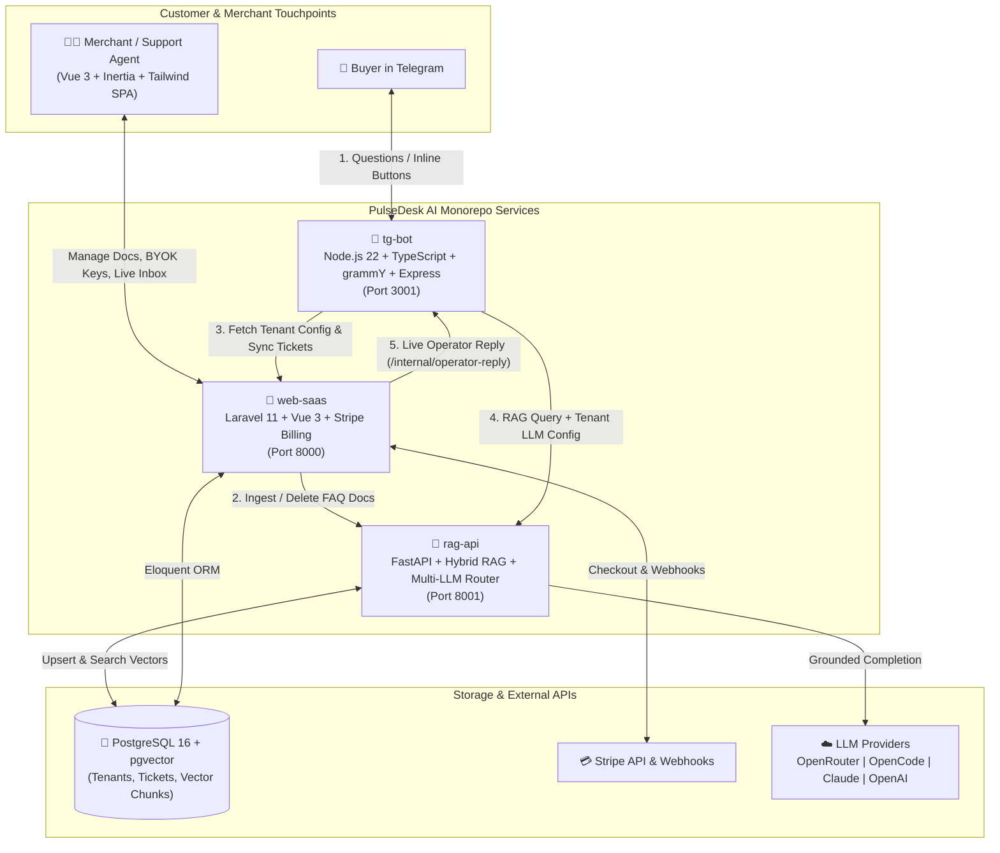
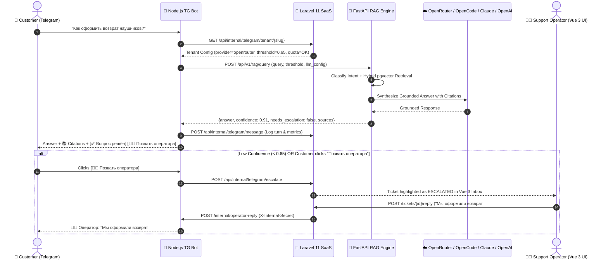

# ⚡ PulseDesk AI — First-Line Customer Support Deflector SaaS

[](.github/workflows/ci.yml)
[](./web-saas)
[](./rag-api)
[](./tg-bot)
[](./web-saas)
[](./LICENSE)

**PulseDesk AI** is an open-source, multi-tenant **AI Customer Support Deflector** built for E-commerce merchants, SaaS products, and digital businesses.

Online stores and digital products drown in repetitive first-line Telegram support tickets (*"Where is my order?"*, *"How do I request a refund?"*, *"Is part X compatible with model Y?"*). **PulseDesk AI** automatically resolves **65–80% of incoming customer questions** in under 2 seconds with grounded RAG citations from the merchant's knowledge base—and seamlessly escalates complex or low-confidence cases to a live human operator (**Human-in-the-Loop**) right inside the Vue 3 Inbox Dashboard.

---

## 🌟 Key Features

- **🔌 Multi-Provider BYOK LLM Router (`openrouter`, `opencode`, `claude`, `openai`)**:
  - Tenants can dynamically select their preferred LLM provider and supply their own API key (**Bring Your Own Key**) directly from the dashboard:
    - **OpenRouter API** *(Default — access Claude, GPT-4o, Gemini, DeepSeek via a single API)*
    - **OpenCode API**
    - **Anthropic Claude API** *(Native `/v1/messages` adapter)*
    - **OpenAI API**
    - **Deterministic Local Fallback (`mock`)** so the entire platform, demo sandbox, and CI tests work out-of-the-box without requiring paid keys.
- **🧠 Hybrid Vector + Lexical RAG (`PostgreSQL + pgvector`)**:
  - Smart Q&A and Markdown document chunker that keeps FAQ blocks and return policy rules intact.
  - Combines cosine vector similarity with lexical/stem matching for exact product SKUs and policy clauses.
- **🤝 Human-in-the-Loop Escalation & Live Operator Bridge**:
  - Automatic intent classification (`faq_question`, `order_status`, `return_refund`, `product_compatibility`, `human_request`, `complaint`).
  - If the RAG `confidence_score` drops below the merchant's threshold (e.g., `0.65`) or the buyer clicks **«👨‍💻 Позвать оператора»**, the ticket switches to `escalated` status.
  - Support agents can reply to the customer directly from the **Laravel + Vue 3 Live Inbox**, and the Node.js bot delivers the reply straight into the user's Telegram chat.
- **💳 Stripe SaaS Billing & ROI Telemetry**:
  - Subscription tiers (`Starter $29/mo`, `Growth $79/mo`, `Scale $199/mo`) with Stripe Checkout & Webhook lifecycle handling (`checkout.session.completed`, `customer.subscription.updated`, `customer.subscription.deleted`).
  - Real-time **AI Deflection Rate (%)** and **Estimated Support Cost Saved ($)** metrics.

---

## 🏗️ System Architecture

### 1. High-Level Microservice Topology



### 2. Customer Support Deflection & Human Escalation Flow



---

## 📂 Repository Structure

```text
.
├── .github/workflows/ci.yml   # Automated CI for Python (Pytest), Node.js (Vitest), and PHP (PHPUnit)
├── docker-compose.yml         # Full-stack orchestration (Postgres+pgvector, Redis, rag-api, web-saas, tg-bot)
├── .env.example               # Root environment configuration template
├── web-saas/                  # Laravel 11 + Vue 3 (Inertia.js, TailwindCSS) SaaS Portal & Stripe Billing
├── rag-api/                   # FastAPI RAG Engine, Document Chunker, pgvector Store & Multi-LLM Router
└── tg-bot/                    # Node.js + TypeScript Telegram Support Bot & Operator Webhook Bridge
```

---

## 🚀 Quickstart

### Option A: Run Everything with Docker Compose (Recommended)

```bash
cp .env.example .env
docker compose up --build -d
```

- **Laravel + Vue 3 SaaS Dashboard:** `http://localhost:8000`
- **FastAPI RAG Engine & Swagger UI:** `http://localhost:8001/docs`
- **Node.js Telegram Bot Internal Bridge:** `http://localhost:3001/health`

### Option B: Local Development & Running Tests

#### 1. FastAPI RAG Engine (`rag-api/`)
```bash
cd rag-api
pip install -r requirements.txt
pytest -v
uvicorn app.main:app --reload --port 8001
```

#### 2. Node.js Telegram Bot (`tg-bot/`)
```bash
cd tg-bot
npm install
npm run typecheck
npm test
npm run dev
```

#### 3. Laravel 11 + Vue 3 SaaS (`web-saas/`)
```bash
cd web-saas
composer install
cp .env.example .env
php artisan key:generate
php artisan migrate --seed
npm install && npm run build
php artisan test
php artisan serve --port=8000
```

---

## 🔑 Supported AI Providers (BYOK)

In the **Vue 3 Dashboard → AI Providers**, any store owner can switch providers on the fly and enter their own API key:

| Provider ID | Default Model | API Endpoint Standard |
| :--- | :--- | :--- |
| `openrouter` *(Default)* | `openai/gpt-4o-mini` | `https://openrouter.ai/api/v1/chat/completions` |
| `opencode` | `opencode-chat-v1` | `https://api.opencode.ai/v1/chat/completions` |
| `claude` | `claude-3-5-sonnet-latest` | `https://api.anthropic.com/v1/messages` |
| `openai` | `gpt-4o-mini` | `https://api.openai.com/v1/chat/completions` |
| `mock` | `pulsedesk-rag-synthesizer-v1` | Built-in zero-cost grounded extractor for local dev & CI |

---

## 📄 License

Released under the [MIT License](./LICENSE).
